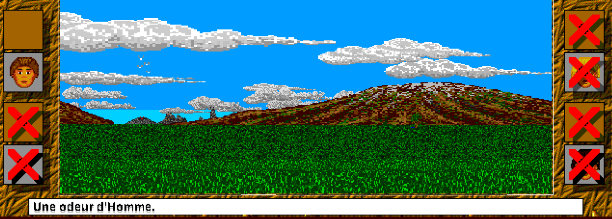
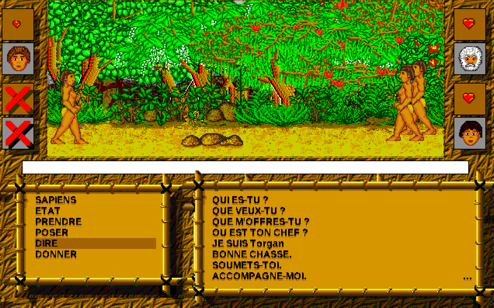

# Sapiens

Portage en Rust de **Sapiens**, jeu de simulation préhistorique écrit en C en
1996 pour Mac OS classique. Le jeu tourne en natif (macOS, Windows, Linux) et
dans un navigateur (WebAssembly).

Toutes les données du jeu (graphismes, polices, musiques, manuel) sont
embarquées dans l'exécutable : il n'y a rien à installer à côté.

## Le jeu

Il y a cent mille ans, la tribu des Pieds-Légers est affamée : sécheresse,
gibier disparu, maladies, loups et ours rôdent. Vous incarnez **Torgan**, un
jeune guerrier envoyé explorer des territoires inconnus pour trouver de quoi
nourrir les siens et survivre dans un monde hostile.

Le jeu se déroule en vue subjective, au fil d'un paysage préhistorique, et se
pilote à la souris avec un menu d'actions : **Sapiens**, **État**, **Prendre**,
**Poser**, **Dire**, **Donner**… Au détour d'une piste, on peut croiser
d'autres hommes : on engage alors la conversation (« Qui es-tu ? », « Que
veux-tu ? », « Accompagne-moi »…), on échange, on s'allie ou on se soumet.
Le manuel complet (situation, repères historiques, maniement, astuces) est
accessible depuis le jeu, en français, anglais et espagnol.

Référence : [page du jeu Sapiens sur Myriad](https://www.myriad-online.com/fr/products/sapiens.htm).

### Captures d'écran



*En chemin, dans la plaine : l'odeur d'un autre homme est dans l'air.*



*Une rencontre : le menu d'actions et les phrases du dialogue.*

## À propos de ce portage

Ce dépôt est une réécriture en **Rust pur** du code C d'origine : il n'y a plus
de FFI ni de compilation C. Les appels à la Toolbox Mac / QuickDraw que le
code d'origine utilisait sont réimplémentés, et l'affichage, les entrées et le
son passent par [egui/eframe](https://github.com/emilk/egui) et `cpal`.
Les sauvegardes `.sap` restent compatibles entre les versions native et web.

Ce portage est le fruit d'un travail personnel de l'auteur, en partie assisté
par intelligence artificielle.

## Prérequis communs

- [Rust](https://rustup.rs/) **stable** (édition 2024, donc Rust ≥ 1.85).

```bash
rustup update stable
```

## Build natif

### macOS

Aucune dépendance supplémentaire (Xcode Command Line Tools suffisent :
`xcode-select --install`).

```bash
cargo run --release
```

### Linux

En plus de Rust, il faut les en-têtes de développement du son (ALSA), du
clavier et de l'affichage. Sur Debian/Ubuntu :

```bash
sudo apt install build-essential pkg-config libasound2-dev \
    libxkbcommon-dev libwayland-dev libx11-dev libxcursor-dev libxrandr-dev libxi-dev libgl1-mesa-dev
cargo run --release
```

Sur Fedora : `sudo dnf install gcc pkgconf-pkg-config alsa-lib-devel libxkbcommon-devel wayland-devel libX11-devel libXcursor-devel libXrandr-devel libXi-devel mesa-libGL-devel`.

Les boîtes de dialogue de fichiers passent par le portail XDG
(`xdg-desktop-portal`, présent sur la plupart des bureaux).

### Windows

Installer Rust avec la chaîne MSVC (proposée par `rustup-init.exe`, avec les
« Build Tools for Visual Studio »), puis :

```powershell
cargo run --release
```

### Exécutable

`cargo build --release` produit `target/release/Sapiens` (`Sapiens.exe` sous
Windows), autonome.

### Options

- `--lang <auto|fr|en|es>` : force la langue (`cargo run --release -- --lang en`).
  Sans option, la dernière langue choisie est reprise, sinon celle du système.
- `SAPIENS_DUMP=/chemin/sortie.ppm` (variable d'environnement, débogage) :
  écrit l'image de la fenêtre toutes les ~2 s.

Préférences et langue sont enregistrées dans
`~/Library/Application Support/Sapiens` (macOS) ou `~/.config/sapiens`
(Linux/Windows) ; les aventures sont sauvées où l'on veut (`~/Documents/sapiens`
proposé par défaut).

## Build web (WebAssembly)

La boucle du jeu d'origine est bloquante : dans le navigateur, elle tourne dans
un Web Worker qui partage sa mémoire avec l'interface. Cela impose :

- Rust **nightly** pour recompiler `std` avec les atomics wasm (les options
  sont dans `.cargo/config.toml` ; le build natif, lui, reste en stable) ;
- une page servie avec les en-têtes **COOP/COEP** (`crossOriginIsolated`).

### Outils (une seule fois)

```bash
rustup toolchain install nightly --component rust-src --target wasm32-unknown-unknown
cargo install --locked trunk
```

Trunk télécharge lui-même la bonne version de `wasm-bindgen` et `wasm-opt`.

### Développement

```bash
RUSTUP_TOOLCHAIN=nightly CARGO_UNSTABLE_BUILD_STD=std,panic_abort trunk serve --release
```

Puis ouvrir <http://127.0.0.1:8080>. `Trunk.toml` envoie déjà les en-têtes
nécessaires. `--release` est conseillé : en debug, le jeu est lent.

Sous Windows (PowerShell) :

```powershell
$env:RUSTUP_TOOLCHAIN="nightly"; $env:CARGO_UNSTABLE_BUILD_STD="std,panic_abort"; trunk serve --release
```

`?lang=fr|en|es` dans l'URL force la langue.

### Publication

```bash
RUSTUP_TOOLCHAIN=nightly CARGO_UNSTABLE_BUILD_STD=std,panic_abort trunk build --release
```

Le site statique est produit dans `target/web/` (page, `.js`, `.wasm` et le
manuel dans `docs/`). Le serveur doit envoyer sur toutes ces ressources :

```
Cross-Origin-Opener-Policy: same-origin
Cross-Origin-Embedder-Policy: require-corp
```

Pour un hébergeur qui ne permet pas de choisir les en-têtes (GitHub Pages par
exemple), ajouter le script
[coi-serviceworker](https://github.com/gzuidhof/coi-serviceworker) à la page.

### Différences avec la version native

- Préférences et langue sont stockées dans le `localStorage` du navigateur.
- « Sauver » télécharge le fichier `.sap` ; « Charger » ouvre le sélecteur de
  fichiers du navigateur. Les fichiers sont compatibles avec la version native.
- Le son n'est pas encore disponible sur le web.
- « Quitter » arrête le jeu et propose de le relancer.

## Tests

```bash
cargo test
```
